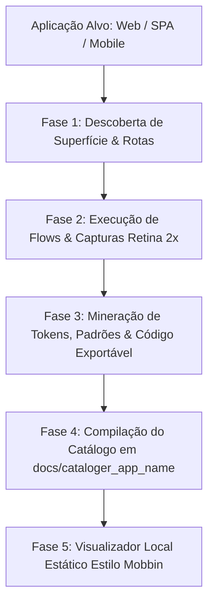

# AIDD-CATALOGER • Catalogador Autônomo de Aplicações Padrão Mobbin

> **Padrão de Governança AIDD:** Determinismo Estrito (Lei #1), Qualidade Binária (Lei #2), Persistência Estruturada (Lei #3), Zero Stubs (Lei #5) e Honestidade de Rótulo (Lei #8).  
> **Propósito:** Transformar qualquer aplicação em um acervo visual, taxonômico e exportável no padrão Mobbin, gerando documentação factual e código reutilizável.

---

## 1. Arquitetura da Informação (Hierarquia Mobbin)

A catalogação segue a estrutura canônica de 5 níveis:
1. **App Profile (`cataloger_{app_name}`):** Metadados do sistema, versão, stack e resumo arquitetural.
2. **User Flows (Jornadas):** Agrupamento cronológico e funcional de telas (ex: *Onboarding*, *Assinatura de Contrato*, *Expedição B2B*, *Ato Cirúrgico*).
3. **Screens (Telas Atômicas):** Capturas em alta fidelidade Retina (Desktop `1440x900` e Mobile `393x852`) nos estados *Default*, *Preenchido*, *Vazio* e *Modais*.
4. **UI Patterns & Components:** Detecção de cartões de preço, steppers, tabelas densas, badges, headers fixos e barras de progresso.
5. **Design Tokens & Código Exportável:** Extração de cores, tipografia, elevações e geração de snippets HTML/CSS isolados prontos para copiar e colar.

---

## 2. Gatilhos & Comandos

- `/aidd-cataloger run [app_name] [url_ou_porta]` — Executa o pipeline completo de catalogação.
  - *Exemplo:* `/aidd-cataloger run kadent http://127.0.0.1:8092`
- `/aidd-cataloger flows [app_name]` — Mapeia apenas as rotas e jornadas sem capturar telas.
- `/aidd-cataloger tokens [app_name] [url]` — Minera e compila exclusivamente os Design Tokens (`tokens.json` e `tokens.css`).
- `/aidd-cataloger export [app_name]` — Gera os snippets de código HTML/CSS isolados de todos os componentes catalogados.

---

## 3. O Pipeline em 5 Fases



### Fase 1 — Descoberta de Superfície (`Surface Discovery`)
1. Analisa os arquivos de rota da aplicação (`app.js`, `routes.tsx`, `urls.py`) ou realiza varredura no DOM via Playwright.
2. Identifica e cataloga:
   - Rotas públicas vs. autenticadas.
   - Parâmetros aceitos (ex: `?tier=GOLD`).
   - Modais, Drawers e overlays acionados por eventos JavaScript.
3. Monta o grafo de transição de telas para cada User Flow.

### Fase 2 — Execução de Flows & Capturas Retina (`Flow Crawling`)
1. Inicializa o Playwright em modo headless com escala de DPI 2x.
2. Para cada tela do fluxo:
   - Configura o viewport Desktop (`1440x900 @2x`).
   - Captura a tela inteira (`fullPage: true`) em formato WebP otimizado.
   - Configura o viewport Mobile (`393x852 @3x - iPhone 15 Pro`) e captura a versão responsiva.
   - Aciona formulários, modais de confirmação e estados vazios, gerando screenshots complementares.
3. Salva em `docs/cataloger_{app_name}/screens/` com nomes semânticos determinísticos:
   - `flow01_onboarding_step01_tier_cards_desktop.webp`
   - `flow01_onboarding_step01_tier_cards_mobile.webp`
   - `flow01_onboarding_step02_modal_novo_tier.webp`

### Fase 3 — Mineração de Tokens, Padrões & Código Exportável
1. **Extração de Tokens:**
   - Injeta script de inspeção de CSS Custom Properties (`--color-*`, `--font-*`, `--spacing-*`, `--radius-*`).
   - Extrai valores computados de fontes (`font-family`, `font-size`, `line-height`), paleta de cores dominante e sombras.
2. **Taxonomia Visual Padrão Mobbin:**
   - Classifica os elementos em tags atômicas: *Sticky Header*, *Pricing Card*, *Stepper*, *Badge*, *Modal Dialog*, *Data Grid*, *Audio Feedback*.
3. **Geração de Código Exportável:**
   - Isola o HTML semântico de cada componente chave.
   - Incorpora o CSS estritamente necessário em arquivo modular (`.html` e `.css`) em `docs/cataloger_{app_name}/components/`.
   - Gera versão com CSS puro e versão comentada com os Design Tokens do projeto.

### Fase 4 — Compilação do Catálogo (`Manifest & Directory Structure`)
Os artefatos são persistidos obrigatoriamente na pasta `docs/cataloger_{app_name}/`:

```
docs/cataloger_{app_name}/
├── manifest.json                  # Metadados relacionais (App -> Flows -> Screens -> Tags)
├── CATALOGO.md                    # Livro canônico com tabelas, links e storytelling
├── tokens/
│   ├── tokens.json                # Design Tokens em JSON padronizado
│   └── tokens.css                 # CSS Custom Properties prontas para reuso
├── screens/                       # Screenshots em alta resolução WebP
│   ├── flow01_step01_desktop.webp
│   └── ...
├── components/                    # Código exportável de componentes atômicos
│   ├── tier_pricing_card.html
│   ├── sticky_header.html
│   └── ...
└── index.html                     # Visualizador web local interativo estilo Mobbin
```

### Fase 5 — Visualizador Local Interativo (`Mobbin-Like Viewer`)
- Gera um arquivo `index.html` autônomo (zero dependências externas, CSS ultra-polido padrão Impeccable):
  - Barra lateral com lista de **User Flows**.
  - Galeria em grade de **Screens** com visualização ampliada (lightbox).
  - Aba de **Código Exportável** com botão de copiar HTML/CSS em um clique.
  - Aba de **Design Tokens** interativa (paleta de cores clicável para copiar HEX/HSL).
  - Seletor de visualização Desktop vs. Mobile.

---

## 4. Quality Gate da Skill (`exit 0` / `exit 1`)

A catalogação só é declarada concluída se:
1. `manifest.json` for válido perante o JSON Schema.
2. Todas as telas mapeadas possuírem screenshots físicos existentes no disco (`sizeBytes > 0`).
3. O visualizador `index.html` renderizar sem erros no console.
4. Os componentes exportados possuírem HTML e CSS autônomos funcionais.
