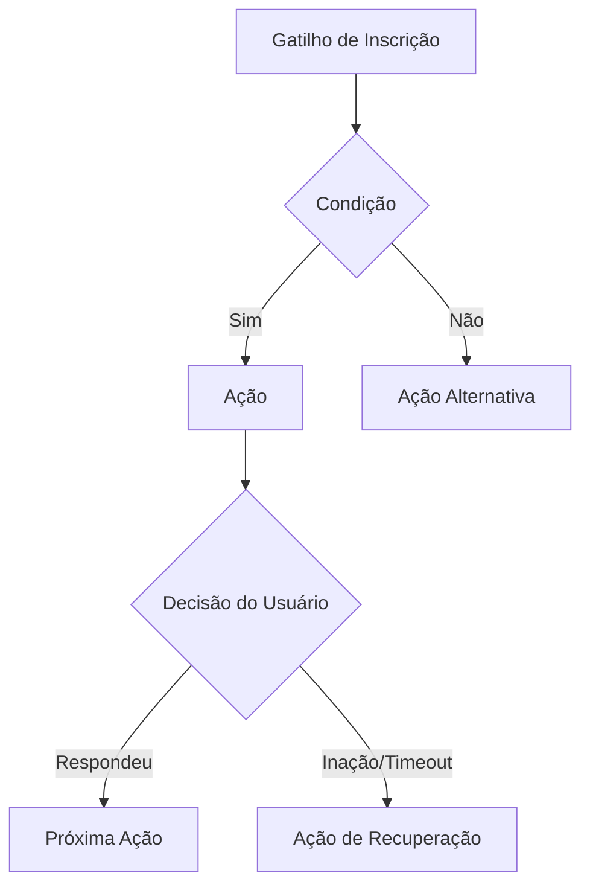

# Especificação Técnica Exaustiva do Motor de Automações (Campaign Builder)

> **Descoberta Factual:** Extraído diretamente do runtime JS da Rvops (`window.Mautic.campaignBuilderConnectionRestrictions`).  
> **Motor de Origem:** Mautic Campaign Engine + Módulos Proprietários Rvops (WhatsApp, Deals, CAPI Meta).

---

## 1. Topologia dos Nós de Automação

O motor de automação da Rvops processa três classes de nós em grafo direcionado acíclico (DAG):

---

## 2. Inventário Completo de Nós Suportados

### A. Ações de Execução (`Actions`)

| Identificador do Nó | Nome Operacional | Parâmetros & Comportamento |
|---|---|---|
| `whatsapp.send` | Enviar WhatsApp | Template ID, Variáveis de interpolação (`{nome}`, `{empresa}`), Provedor (Oficial Cloud API / Baileys). |
| `email.send` | Enviar E-mail | Template HTML, Assunto, Remetente e Headers de tracking. |
| `email.send.to.user` | Alerta Interno por E-mail | Notifica vendedor responsável ou gestor de vendas. |
| `deal.changestage` | Mover Estágio no Funil | Pipeline ID, Stage ID destino, alteração de probabilidade. |
| `tags.deal` | Gerenciar Tags do Deal | Adicionar ou remover etiquetas do negócio. |
| `lead.changepoints` | Alterar Pontos (Lead Score) | Incremento (+) ou decremento (-) numérico na pontuação do lead. |
| `lead.changetags` | Gerenciar Tags do Lead | Adicionar ou remover etiquetas de qualificação. |
| `lead.changeowner` | Atribuir Proprietário | Roleta de distribuição (Round-Robin) entre vendedores de uma equipe. |
| `task.create` | Criar Tarefa | Título, Tipo (Ligação, Reunião, WhatsApp), Prazo relativo (ex: +2 dias). |
| `conversion.api` | Disparar Conversão Meta CAPI | Evento (`Lead`, `Purchase`), valor, moeda e hash de dados para Meta Ads. |
| `campaign.sendwebhook` | Disparar Webhook Externo | URL de endpoint, Método POST/PUT, Payload JSON customizado e Headers. |
| `sms.send` | Disparar SMS | Provedor de SMS e texto da mensagem. |
| `workflow.delay` | Pausa / Atraso | Aguardar tempo fixo (X minutos, horas, dias) ou até horário comercial específico. |
| `objects.create` | Criar Objeto | Criação dinâmica de Empresa, Negócio ou Ticket associado. |
| `value.copy` | Copiar Propriedade | Copia o valor de um campo para outro objeto. |
| `lead.changelist` | Mover de Segmento | Adicionar ou remover o lead de uma lista/segmento de base. |
| `lead.adddnc` / `lead.removednc` | Gestão de Não Perturbe (DNC) | Adiciona ou remove bloqueio de comunicação (Opt-out LGPD). |
| `campaign.jump_to_event` | Salto de Fluxo (Goto) | Redireciona o contato diretamente para outro nó do canvas. |

---

### B. Condições de Filtragem (`Conditions`)

| Identificador do Nó | Validação |
|---|---|
| `lead.propertyvalue` | Valida se qualquer campo do lead (ex: Cargo, Cidade, Faturamento) atende ao operador (igual, contém, maior que). |
| `lead.tags` | Valida se o lead possui ou não uma determinada tag. |
| `lead.segments` | Valida se o lead pertence ao segmento X. |
| `form.field_value` | Valida o valor preenchido em uma pergunta específica de formulário. |
| `workflow.delayContact` | Pausa condicional até que uma condição seja satisfeita. |
| `email.validate.address` | Valida a sintaxe e reputação de entrega do domínio do e-mail. |
| `campaign.abtest` | Divide o tráfego em porcentagens configuráveis (ex: 50% Caminho A, 50% Caminho B). |

---

### C. Decisões do Usuário (`Decisions` - Eventos de Retorno)

| Identificador do Nó | Gatilho Comportamental | Caminhos de Saída |
|---|---|---|
| `whatsapp.reply` | O contato respondeu à mensagem de WhatsApp | **Sim** (resposta recebida) / **Não** (após timeout) |
| `whatsapp.open` | O contato leu a mensagem (double check azul) | **Sim** (lido) / **Não** |
| `email.open` | O contato abriu o e-mail | **Sim** / **Não** |
| `email.click` | O contato clicou em qualquer link do e-mail | **Sim** / **Não** |
| `email.reply` | O contato respondeu ao e-mail | **Sim** / **Não** |
| `page.pagehit` | O contato acessou uma URL com o script de tracking | **Sim** / **Não** |
| `form.submit` | O contato enviou um formulário integrado | **Sim** / **Não** |
| `asset.download` | O contato fez download de um material/arquivo | **Sim** / **Não** |

---

## 3. Mapeamento 1:1 com Motores Open Source

| Módulo Rvops | Motor Open Source Recomendado | Justificativa Técnica |
|---|---|---|
| **Campaign Builder (Canvas de Automação)** | **Mautic Core** | O código da Rvops é derivado do Mautic. Compatibilidade nativa de esquemas. |
| **Email Builder (Templates Drag & Drop)** | **GrapesJS / Beefree SDK** | O bundle `MauticBeefreeBundle` usa a mesma biblioteca de blocos drag-and-drop. |
| **WhatsApp Omnichannel & Chat** | **Evolution API + Chatwoot** | Suporte completo a Webhooks de envio/recebimento, leitura, templates e multi-atendentes. |
| **CRM, Pipelines & Negócios** | **Twenty CRM** ou **Mautic Deals Plugin** | Modelos relacionais nativos de Deal, Stage, Contact e Company com SQLite WAL/Postgres. |
