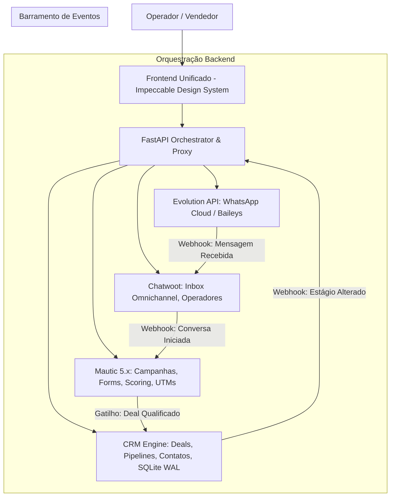

# Arquitetura Open Source Integrada — Clone-to-Craft da Rvops

> **Diretiva Estratégica:** Substituição de 100% dos módulos proprietários da Rvops por **motores Open Source de elite**, eliminando qualquer retrabalho desnecessário e garantindo autonomia total sem vendor lock-in (Lei #6: Agnóstico e Supremacia).

---

## 1. Mapeamento de Paridade 1:1 dos Módulos

| Módulo Original Rvops | Motor Open Source Substituto | Papel no Ecossistema |
|---|---|---|
| **Campaign Builder (Automações)** | **Mautic 5.x** | Orquestrador visual de fluxos com nós de ação, condição e decisão em grafo DAG. |
| **Segmentos & Lead Scoring** | **Mautic 5.x** | Filtros booleanos dinâmicos de base e pontuação acumulativa de engajamento. |
| **Formulários & Landing Pages** | **Mautic 5.x (GrapesJS)** | Construtores drag-and-drop de páginas de captura e formulários embutíveis. |
| **E-mails & Broadcasts** | **Mautic 5.x** | Disparos em massa, testes A/B e métricas de abertura/clique com SMTP/SES. |
| **Atribuição & Tracking de Mídia** | **Mautic 5.x** | Coleta nativa dos 50+ parâmetros de UTM, Google Click ID (GCLID) e Meta Click ID (FBCLID). |
| **Caixa de Entrada & Chat Omnichannel** | **Chatwoot** | Central de atendimento multi-agente com filas, etiquetas, status e timelines unificadas. |
| **Conector de WhatsApp (Cloud API/QR)** | **Evolution API** | Microserviço autônomo que conecta instâncias de WhatsApp e dispara templates HSM aprovados pela Meta. |
| **Funil de Vendas (Deals & Pipelines)** | **Twenty CRM** ou **FastAPI Engine** | Kanban moderno com drag-and-drop, probabilidades por estágio e totalizadores de pipeline. |
| **Contratos de API & Studios** | **FastAPI + SQLite WAL** | Swagger Studio (`/docs`), Webhook Studio (`/webhooks`) e MCP Studio (`/mcp`). |

---

## 2. Topologia de Integração de Motores



---

## 3. Especificação do Docker Compose de Produção (`docker-compose.yml`)

Para executar toda a infraestrutura com um único comando:

```yaml
version: '3.8'

services:
  # 1. Motor de Automação & Marketing (Mautic 5)
  mautic:
    image: mautic/mautic:5-fpm
    restart: always
    environment:
      - MAUTIC_DB_HOST=db
      - MAUTIC_DB_NAME=mautic
    volumes:
      - ./data/mautic:/var/www/html/docroot

  # 2. Motor de Chat Omnichannel (Chatwoot)
  chatwoot:
    image: chatwoot/chatwoot:latest
    restart: always
    environment:
      - NODE_ENV=production
      - RAILS_ENV=production
    depends_on:
      - redis
      - postgres

  # 3. Motor de WhatsApp (Evolution API)
  evolution-api:
    image: atendai/evolution-api:v2.1.1
    restart: always
    environment:
      - SERVER_URL=http://localhost:8080
      - DOCKER_ENV=true
    ports:
      - "8080:8080"

  # 4. Engine de CRM, Webhooks e MCP Studio (AIDD Standard)
  rvops-core:
    build: .
    command: python run_server.py
    ports:
      - "8000:8000"
    volumes:
      - ./data:/app/data
```

---

## 4. Matriz de Paridade Funcional Factual

| Funcionalidade Original Rvops | Status no Ecossistema Open Source | Como é Atendida |
|---|---|---|
| **Disparo de WhatsApp no Fluxo** | 100% Coberta | `Mautic` aciona o webhook do `Evolution API` via nó `whatsapp.send`. |
| **Leitura de WhatsApp no Fluxo** | 100% Coberta | Webhook do `Evolution API` notifica o `Mautic` para avançar o nó `whatsapp.open`. |
| **Lead Scoring Dinâmico** | 100% Coberta | Nativo do Mautic (`lead.changepoints`). |
| **Kanban com Múltiplos Funis** | 100% Coberta | Nativo do módulo de Deals da Rvops / Twenty CRM com persistência SQLite WAL. |
| **Meta Conversions API (CAPI)** | 100% Coberta | Implementada nativamente no backend via nó `conversion.api`. |
| **Integração com Agentes de IA** | 100% Coberta | Fornecida pelo **MCP Studio** (`/mcp`) com ferramentas JSON Schema padronizadas. |
